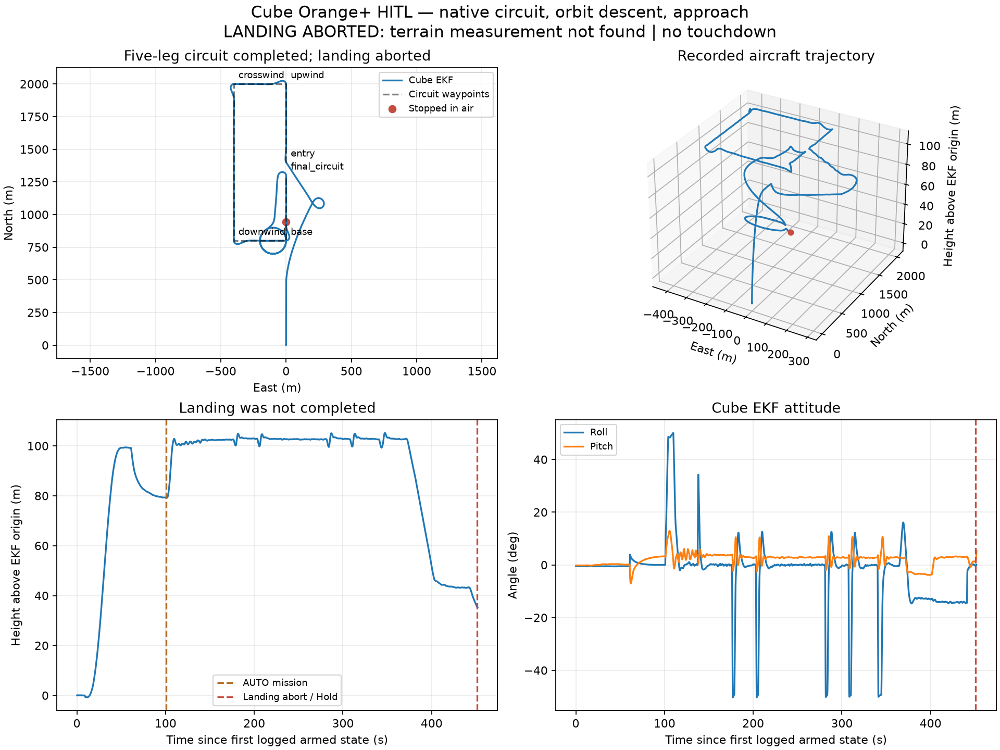

# PX4 SkySurfer / Cube Orange+ 進度備份

2026-10-21，本次來源提交 `49a8bfd`，分支 `carrier-release-20261021`。

- `source-49a8bfd.zip`：完整已追蹤原始碼快照，包括模型、配方、SITL、HIL、任務、測試與結果文件。
- `carrier-circuit-progress.bundle`：完整 Git 歷史與目前分支，可還原為正常 Git 專案。
- `trajectory.png`、`postmortem.json`：最近一次 Cube HIL 的軌跡與除錯結論。

## 還原程式與版本歷史

下載 bundle 後：

```sh
git clone carrier-circuit-progress.bundle px4-llm-sim2hitl
cd px4-llm-sim2hitl
git switch carrier-release-20261021
```

解壓縮 ZIP 也可取得相同版本的原始碼。機器環境、依賴及 PX4 外部原始碼依專案 README 準備；未上傳大型原始 ULog、暫存建置與本機環境。

## 目前測試狀態

SITL 完成 100 m／30 節母機釋放、五邊、盤旋下降與接地流程。Cube Orange+ HIL 完成空投、五邊、盤旋下降與最後進場，但約 36 m 高時因 `Landing aborted: terrain measurement not found` 中止降落，未接地，不能視為整體通過。

HIL 缺少有效對地量測，SITL 真值 stub 有提供，下一步需驗證模擬向下測距方案。尚未關閉地形／降落中止檢查。航點與測試修改參數已還原、Cube 已解除解鎖，無待恢復。完整技術紀錄見 ZIP／bundle 內 `missions/README.md`。


