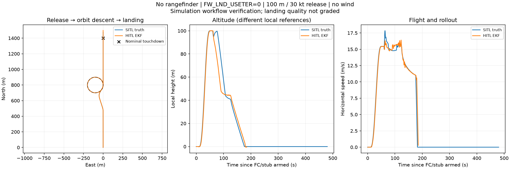

# SkySurfer / Cube Orange+ HIL 進度備份

## 最新：停用地形量測後直接盤旋降落（2026-10-22）

**本次完成：100 m／30 節母機釋放 → 約 1.17 圈盤旋下降 → 下滑道 → 降落減速。沒有五邊與 40 秒觀察段。**

- `FW_LND_USETER=0`，`flat_rangefinder=false`，不啟用新增的向下測距產生／傳送。`FW_LND_ABORT=3` 保留，在 USETER=0 時地形中止條件不作用。
- Cube log 358 的1851筆local position均沒有有效對地距離，distance_sensor零筆；Commander與Navigator都記錄完成落地。
- SITL與HITL皆約1.17圈；HITL解鎖後約185.16秒回報落地，附近EKF水平速度約0.28 m/s。著陸品質尚未評定。
- 新FC log 358（測前最新357）雙下載一致、嚴格解析通過；零漏拍。參數、航點與標準恢復皆通過，未解鎖、SYS_HITL=1、無pending。

[完整報告](20261022-orbit-no-range/report.md) · [數字與量測方法](20261022-orbit-no-range/analysis.json) · [還原核對](20261022-orbit-no-range/cleanup.json)



### 程式與證據

可直接瀏覽／clone的程式分支：[carrier-orbit-no-range-20261022](https://github.com/cana511283/px4-llm-sim2hitl-private/tree/carrier-orbit-no-range-20261022)，來源commit `96d4691`。程式的使用規格在該分支 `missions/orbit_no_range.md`。

`20261022-orbit-no-range/`：

- `source.zip`、`source.bundle`：完整已追蹤來源，以及包含新分支的Git歷史。
- `mission-plan/`：本次JSON航點與QGC計畫。
- `fc-log-358.zip`：一份完整原始ULog；雙下載核對資訊保留在runner結果。
- `hitl-run-evidence.zip`：runner原始結果、逐次status／operation、agent wire、參數測前測後讀回、交易與還原資料；不重複保存第二份相同ULog或既有韌體影像。
- `owner-wire-and-timing.zip`：owner的wire、4ms時序、來源身分及診斷擷取。bridge保持開啟，因此擷取範圍與每檔SHA詳見`manifest.json`。
- `manifest.json`：所有交付檔案的大小與SHA-256。

### 取得可接續開發的版本

```sh
git clone --branch carrier-orbit-no-range-20261022 https://github.com/cana511283/px4-llm-sim2hitl-private.git
```

或下載`source.bundle`後：

```sh
git clone source.bundle px4-llm-sim2hitl
cd px4-llm-sim2hitl
git switch carrier-orbit-no-range-20261022
```

環境、模型release與PX4依賴依程式分支README準備。此處是模擬流程驗證，不是實機安全著陸判定。

---

## 上一次：開啟平面測距的五邊降落備份


最新更新：2026-10-22；程式版本 `9ea1a9674acd57d9d237adcdad19c9d845de49c7`，分支 `carrier-release-20261021`。

本次完成 100 m／30 節母機釋放、40 s 穩定觀察、原生五邊、盤旋下降、最後進場及降落。新增平面向下測距，飛控已有有效對地高度，未再觸發 terrain_not_found。約解鎖後496.73 s判定落地，當時EKF水平速度約0.55 m/s。流程完成，尚未評定實機著陸品質。

## 本次檔案

- `source-flat-range.zip`：完整已追蹤程式、模型來源、設定、測試及文件。
- `carrier-flat-range.bundle`：完整 Git 歷史與最新分支。
- `mission-settings.zip`：實際航點JSON、QGC plan、空投／測距場景與試驗／還原參數配方。
- `fc-log-357.zip`：原始飛控 ULog 357，雙下載一致，嚴格解析通過；保留一份原始檔。
- `hil-reports-and-settings.zip`：原始runner結果、逐次狀態、參數前後備份、交易紀錄、圖表與離線測試結果。
- `hil-agent-wire.zip`、`hil-native-wire-and-timing.zip`：agent wire、原生準備／飛行時段wire、4 ms時序、來源身分與診斷。原生wire保留標準二進位格式與擷取時間窗，排除事後下載日誌的重複傳輸流量。
- `trajectory.png`、`flight-analysis.json`、`cleanup-verification.json`：可直接查看的摘要。
- `manifest-20261022.json`：檔案大小、SHA-256與ULog核對資訊。

## 還原原始碼與歷史

```sh
git clone carrier-flat-range.bundle px4-llm-sim2hitl
cd px4-llm-sim2hitl
git switch carrier-release-20261021
```

環境與PX4依賴另依來源專案README準備；任務配方涉及的已建置韌體檔不包含在任務設定壓縮檔內。新版模型release為 `skysurfer-5e8343f64ea32411a30665ec`。

## 證據與還原

ULog原始SHA-256：`a30ea19a95e8f4400c51bf74ae0e9cdaea92c6e429956fb83da699caf9b63fbc`。之前最新log356，本次357，雙下載相同，嚴格解析PASS，時序零漏拍。4875／4968筆local position具有有效對地高度。

原runner因飛控自動更新ASPD_SCALE_1而出現最後證據核對錯誤，原始result.json保留。已另外交易還原至測前1.0並核對；航點與試驗參數還原完成、armed=false、SYS_HITL=1、無pending。其餘差異均為FC-owned校正及飛行計數。詳細補充見flight-analysis與cleanup-verification。

先前49a8bfd版的檔案與postmortem仍保留，為尚未完成降落時的歷史紀錄。


## 大型日誌分卷還原

網頁提交限制，因此下列ZIP改存為 `.part01`、`.part02` 等分卷。下載同名全部分卷後，以檔名順序合併：

```sh
cat fc-log-357.zip.part* > fc-log-357.zip
cat hil-reports-and-settings.zip.part* > hil-reports-and-settings.zip
cat hil-agent-wire.zip.part* > hil-agent-wire.zip
cat hil-native-wire-and-timing.zip.part* > hil-native-wire-and-timing.zip
```

合併後再解壓；原ZIP及各分卷的SHA-256見manifest。原始資料無截短。
